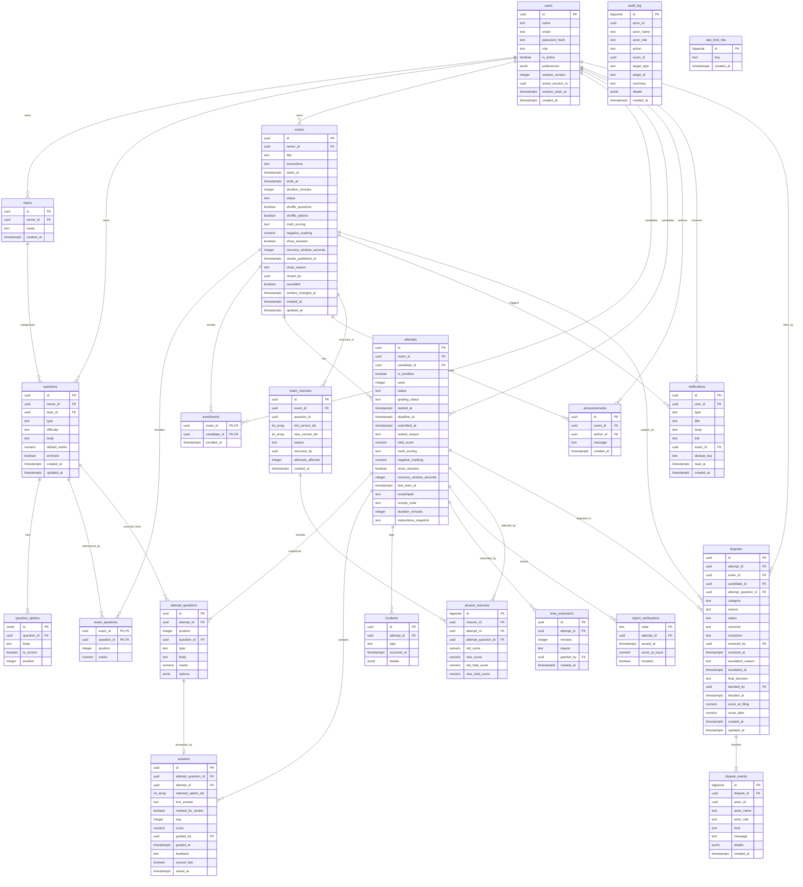
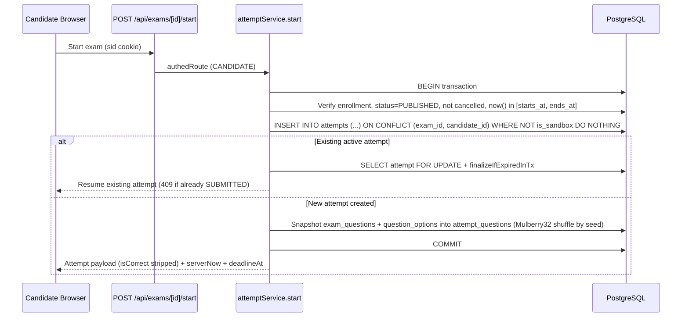
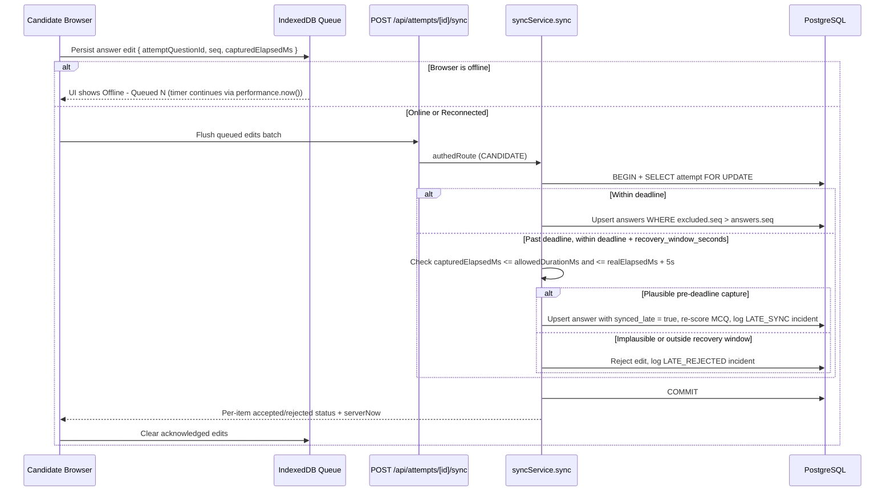
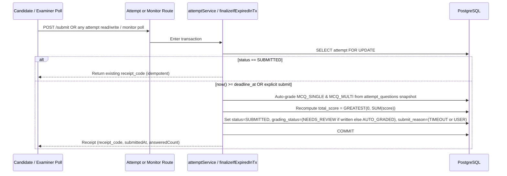
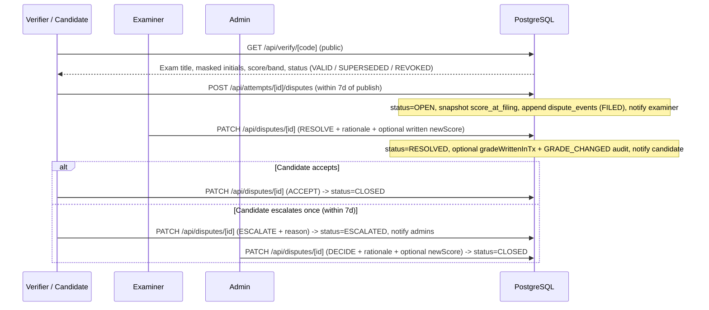

# 02 - System Design and Data Model

## 1. Entity-Relationship Diagram (Generated from Migrations `001` through `016`)

Every table and column below matches `db/migrations/001_init.sql` through `db/migrations/016_disputes.sql`. The starter `items` table created in `001_init.sql` is dropped in `003_drop_items.sql` and omitted. The view `real_attempts` is defined as `SELECT * FROM attempts WHERE NOT is_sandbox` (refreshed in `011_refresh_real_attempts_view.sql`).



## 2. Migration Register and Database Constraints (`001` through `016`)

| Migration | Tables / Objects | Key Constraints and Rationale |
|---|---|---|
| `001`–`003` | `users` (drops starter `items`) | `CHECK (role IN ('ADMIN','EXAMINER','CANDIDATE'))`, `UNIQUE (lower(email))`, `is_active boolean`, `preferences jsonb`. |
| `004` | `topics`, `questions`, `question_options` | `UNIQUE (owner_id, lower(name))` on topics for race-free import `ON CONFLICT`; `archived` soft-delete; `ON DELETE RESTRICT` on `topic_id`; `UNIQUE (question_id, position)` on options. |
| `005` | `exams`, `exam_questions`, `enrollments` | `CHECK (starts_at < ends_at)`, `CHECK (duration_minutes > 0)`, `CHECK (negative_marking BETWEEN 0 AND 1)`, `CHECK (recovery_window_seconds BETWEEN 0 AND 600)`. Composite PK `(exam_id, question_id)` + `DEFERRABLE` unique `(exam_id, position)`. Composite PK `(exam_id, candidate_id)` on enrollments. |
| `006` | `attempts`, `attempt_questions`, `answers`, `real_attempts` view | Partial unique index `attempts_real_unique_idx` `(exam_id, candidate_id) WHERE NOT is_sandbox`; second partial unique index `WHERE is_sandbox`; `real_attempts` view excludes sandbox attempts globally; `answers.attempt_question_id UNIQUE` + monotonic `seq` for idempotent autosave. |
| `007` | `incidents`, `announcements`, `time_extensions` | Closed `CHECK` on 8 incident types; `time_extensions` enforces `minutes BETWEEN 1 AND 120` and `reason` (`3..500` chars). |
| `008` | `report_verifications` | `code` PK (`>= 12` chars), `score_at_issue` compared against live `attempts.total_score` to detect `SUPERSEDED` reports; `revoked` flag for cancelled exams. |
| `009` | `users.session_version`, `rate_limit_hits` | Server-side session revocation (`ADM-108`) and PostgreSQL-backed sliding-window rate limiting (`ADV-131`). |
| `010`–`011` | `attempts.receipt_code`, `audit_log`, refreshed `real_attempts` | Unique `NP-XXXX-XXXX` confirmation codes; append-only `audit_log` enforced by `BEFORE UPDATE OR DELETE` trigger (`audit_log_no_change`). |
| `012` | `exams` lifecycle columns, `attempts` snapshot columns, `exam_rescores`, `answer_rescores` | Adds `close_reason`, `closed_by`, `cancelled`, `content_changed_at` on `exams`; snapshots `duration_minutes` and `instructions_snapshot` on `attempts`; stores audited MCQ rescore history. |
| `013` | `audit_log` action check | Adds `PASSWORD_CHANGED` and `PASSWORD_RESET` to `audit_log_action_check`. |
| `014` | `users.active_session_id`, `users.session_seen_at` | Enforces one active session per account (`SESSION_IDLE_SECONDS = 120`). |
| `015` | `notifications` | `UNIQUE (user_id, dedupe_key)` guarantees idempotent event and lazy time-based notifications; partial index on unread rows. |
| `016` | `disputes`, `dispute_events` | Partial unique index `disputes_one_active_idx` limits one live dispute per question (or whole result); `CHECK` requires outcome for resolved/escalated/closed; append-only trigger `dispute_events_no_change`; extends `audit_log` and `notifications` constraints. |

## 3. Key Flow Sequence Diagrams

### 3.1 Start Attempt and Immutable Snapshot



### 3.2 Offline Autosave and Bounded Sync (Innovation 5.3)



### 3.3 Submit and Lazy Server-Enforced Expiry



### 3.4 Grading, Answer-Key Rescore, and Results Publish

```mermaid
sequenceDiagram
  participant E as Examiner Browser
  participant API as Grading / Publish / Rescore API
  participant SVC as gradingService / examService
  participant DB as PostgreSQL

  E->>API: PATCH /api/attempts/[id]/grade/[aqId] (score in 0.5 steps, feedback)
  API->>SVC: Verify exam owner
  SVC->>DB: BEGIN + SELECT attempt FOR UPDATE
  SVC->>DB: Update answer score/feedback + recompute total_score + update grading_status (GRADED when all written graded)
  SVC->>DB: INSERT audit_log (GRADE_CHANGED) + COMMIT
  E->>API: POST /api/exams/[id]/results/publish
  SVC->>DB: Finalize expired attempts; reject 409 if any real attempt is NEEDS_REVIEW
  SVC->>DB: SET exams.results_published_at = now() + INSERT notifications + audit_log (RESULTS_PUBLISHED)
  opt Post-publish MCQ key correction
    E->>API: POST /api/exams/[id]/rescore
    SVC->>DB: Update snapshot key, recompute affected answers & totals, log exam_rescores + answer_rescores + audit_log (EXAM_RESCORED)
  end
```

### 3.5 Public Verification and Two-Level Dispute Resolution



## 4. Technology Selection

| Layer | Technology | Rationale |
|---|---|---|
| Framework | Next.js 16 (App Router) + React 19 + TypeScript 5 | Unified full-stack route handlers, server components, and strict end-to-end typing. |
| Styling and UI | Tailwind CSS v4 + Radix UI primitives + Lucide icons | Accessible, composable components with zero external runtime design-system lock-in. |
| Database | PostgreSQL + `pg` (parameterized SQL) | Direct control over `FOR UPDATE` row locks, partial unique indexes, `DEFERRABLE` constraints, views, and append-only triggers without ORM abstraction leaks. |
| Validation | Zod v4 + React Hook Form | Single shared schemas in `src/shared/schemas/**` validated on both client and server. |
| Client State and Caching | TanStack Query + IndexedDB (`src/lib/offline-queue.ts`) | Declarative polling/cache invalidation plus durable offline-first answer storage. |
| Auth and Security | `jose` (HS256 JWT in HttpOnly cookie) + `bcryptjs` | Signed session tokens backed by PostgreSQL `session_version` and `active_session_id` checks on every request. |
| Reports and Charts | `jsPDF` + `qrcode` + `recharts` + `papaparse` | Pure-JS server-side PDF/QR generation (no headless Chromium needed), interactive analytics charts, and reliable CSV parsing. |

## 5. Security Architecture

- **Authentication and session integrity**: Passwords hashed with `bcryptjs` (cost 10). `sid` cookie is `HttpOnly`, `SameSite=Lax`, `Secure` in production, signed with HS256 (`SESSION_SECRET`). Every request validates `user.is_active`, `session_version`, and `active_session_id` against PostgreSQL.
- **Authorization**: Every protected route uses `authedRoute({ roles })` (`src/server/http.ts`), and every service enforces ownership (`owner_id` / `candidate_id`), returning `403` for wrong role and `404` for cross-tenant records to avoid ID enumeration.
- **Rate limiting**: PostgreSQL-backed sliding-window table `rate_limit_hits` keyed by client IP (proxy-safe: ignores `X-Forwarded-For` unless `VERCEL=1` or `TRUST_PROXY=true`) and per-email on login.
- **Injection and XSS defense**: Parameterized SQL (`$1..$n`) everywhere; React text rendering for all user content; HTTP headers `X-Content-Type-Options: nosniff`, `X-Frame-Options: DENY`, `Referrer-Policy: strict-origin-when-cross-origin`; CSV formula prefix rejection on import and leading-quote neutralization on export.
- **Concurrency safety**: Row-level `FOR UPDATE` locks on attempts across autosave, sync, submit, lazy expiry, grading, late-sync discard, and time extensions; `ON CONFLICT DO NOTHING` on attempt start; optimistic concurrency (`updatedAt`) on exam edits.

## 6. Decisions Log

Full rationale for all 15 architectural decisions and security fixes is maintained in [docs/DECISIONS.md](../DECISIONS.md).
