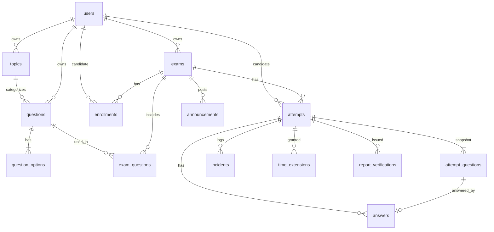

# 02 — System Design & Data Model

## 1. Entity-Relationship Diagram

## 2. Database Schema & Integrity Constraints (`db/migrations/001..008`)

| Migration | Tables / Objects | Key Constraints & Rationale |
|---|---|---|
| `001`–`003` | `users` (drops starter `items`) | `CHECK (role IN ('ADMIN','EXAMINER','CANDIDATE'))`, `UNIQUE (lower(email))`, `is_active boolean`, `preferences jsonb`. |
| `004` | `topics`, `questions`, `question_options` | `UNIQUE (owner_id, lower(name))` on topics for race-free import `ON CONFLICT`; `archived` soft-delete preserves historical exams; `ON DELETE RESTRICT` on `topic_id`; `UNIQUE (question_id, position)` on options. |
| `005` | `exams`, `exam_questions`, `enrollments` | `CHECK (starts_at < ends_at)`, `CHECK (duration_minutes > 0)`, `CHECK (negative_marking BETWEEN 0 AND 1)`, `CHECK (recovery_window_seconds BETWEEN 0 AND 600)`. Composite PK `(exam_id, question_id)` + `DEFERRABLE` unique `(exam_id, position)` for atomic reorders. Composite PK `(exam_id, candidate_id)` on enrollments. |
| `006` | `attempts`, `attempt_questions`, `answers`, `real_attempts` view | Partial unique index `(exam_id, candidate_id) WHERE NOT is_sandbox` prevents duplicate real attempts under double-click/race; second partial unique index `WHERE is_sandbox` bounds sandbox previews; `real_attempts` view guarantees sandbox attempts are excluded from every stat, grading list, monitor, analytics, and PDF report; `answers.attempt_question_id UNIQUE` + monotonic `seq` guarantees idempotent autosave. |
| `007` | `incidents`, `announcements`, `time_extensions` | Closed `CHECK` on incident types; `time_extensions` enforces `minutes BETWEEN 1 AND 120` and required `reason` (`3..500` chars). |
| `008` | `report_verifications` | `code` PK (`>= 12` random uppercase hex chars), `score_at_issue` compared against live `attempts.total_score` to detect `SUPERSEDED` reports automatically. |

## 3. Concurrency & Consistency Patterns
- **Start Attempt Race Safety**: `INSERT INTO attempts ... ON CONFLICT (exam_id, candidate_id) WHERE NOT is_sandbox DO NOTHING` inside a transaction ensures two simultaneous clicks never create duplicate attempts.
- **Row-Level Locking (`FOR UPDATE`)**: Autosave, sync, submit, lazy expiry (`finalizeIfExpiredInTx`), written grading, late-sync discard, and time extensions all lock the `attempts` row `FOR UPDATE` inside a PostgreSQL transaction, eliminating double-grading or post-submit write races.
- **Single-Statement Score Recomputation**: `attempts.total_score` is always recomputed via `GREATEST(0, COALESCE((SELECT SUM(score) FROM answers WHERE attempt_id = a.id), 0))` in the same transaction as any score mutation.

## 4. Client Resilience & Monotonic Clock
- On load and every 10s heartbeat, the client receives `{ serverNow, deadlineAt }` and anchors `clockRef = { serverNowMs, anchorPerfMs: performance.now(), deadlineMs }`. Remaining time is computed purely from elapsed monotonic ticks, immune to local OS clock changes.
- Every answer mutation writes to IndexedDB (`src/lib/offline-queue.ts`, `localStorage` fallback) before attempting network sync (`POST /api/attempts/[id]/sync`), retrying with exponential backoff (2s → 15s) and immediately on `online` / `/api/ping` recovery.
