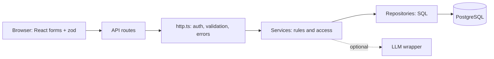
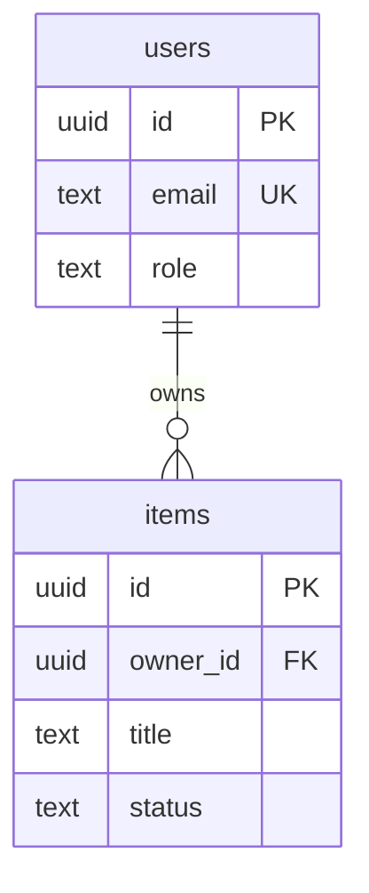

# 02. Design: {{PROJECT_NAME}}

## 1. Design approach
Layered architecture (route -> service -> repository -> PostgreSQL). Shared zod schemas for validation on both sides. Server-side access control; hidden records return 404.
{{Why this approach fits the constraints in 3 sentences.}}

## 2. Architecture

## 3. Database design (ERD)

Replace with your real entities. For each table add one line: purpose, keys, constraints, indexes, normal form.

## 4. Key flows
Sequence or numbered steps for the 2-3 most important flows (e.g. booking: validate -> check availability -> transaction -> response).

## 5. Technology selection
| Concern | Options considered | Chosen | Why | Trade-off |
|---|---|---|---|---|
| Framework | Express+React, Django, Next.js | Next.js (TypeScript) | One codebase for UI and API, strong typing, fast to deploy | Server/client boundary needs care |
| Database | MongoDB, SQLite, PostgreSQL | PostgreSQL | Relational data, constraints, transactions | Needs hosting |
| Validation | Manual, Joi, zod | zod (shared) | Same schema in browser and server | |
| Auth | Sessions in DB, NextAuth, JWT cookie | Signed JWT in httpOnly cookie + bcrypt | Simple, no extra service | Role re-read from DB each request |
| UI | Bootstrap, MUI, Tailwind | Tailwind + small component kit | Consistent tokens, small bundle | |
| Hosting | {{}} | {{}} | {{}} | |

## 6. Security and quality measures
Parameterized SQL, bcrypt hashes, httpOnly + SameSite cookies, rate limiting on auth, uniform error format, no secrets in the client, DB constraints.

## 7. Design decisions log
| Decision | Alternatives | Reason |
|---|---|---|
